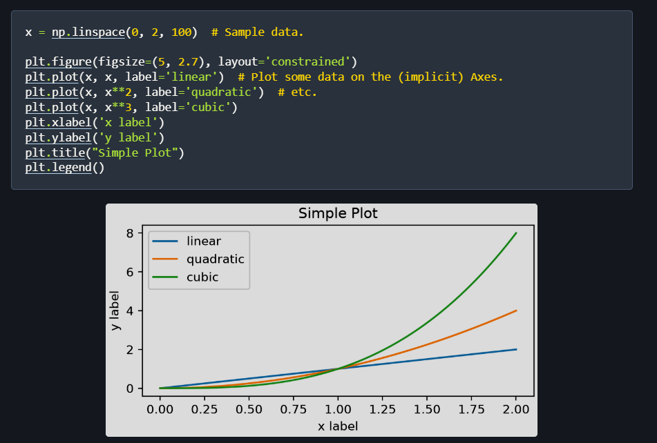
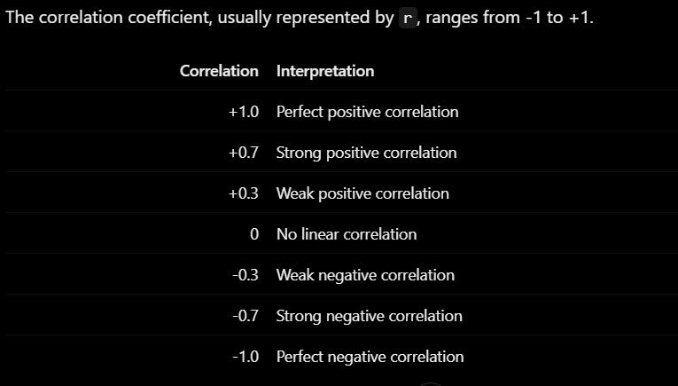

# Starting Matplotlib
- .show(): show the plot, some application like jupyter note book skip this call, plot are automatically shown

- scatter():
- plot():
- bar():
- size of figure: To change the figure size in Matplotlib, specify the figsize parameter as a tuple of (width, height) in inches. The default size is 6.4 by 4.8 inche

# ploting the df
- we can call the .plot(kind=plottype) method directly on to the df object. we need to specify the name of the plot type as a string
- histogram, to know the distribution of range of value
- bins is number of intervals in between, the more bins the more details the distributions
- four kind of distribution: 
    1. Normal distribution: mass at the center
    2. left skewer: the distribution lean to ward the left
    3. right skewer
    4. uniformity: distributed evenly across
- scatter: explore relation ship between two number: does salary increase with year of experiece?
- df.plot(kind='scatter', x='col1', y='col2')
- correlation: allow measure strength and direction of the linear relationship between two values. scatter plot can do this visually
- df['col1'].corr(df['col2']): get correlation bewteen col1 and col2
- can also do this among the cols: df.corr(numeric_only=True) which result in a matrix
- we can plot this matrix
- plt.imshow(correlation_matrix, cmap='coolwarm')
- xticks(number of ticks, title of the ticks, rotation optional)
- yticks
- Correlation efficiency

**IMPORTANT NOTE ABOUT CORRELATION**: correlation does not mean causation, strong relationship between certain two properties does not decide the outcome, there are many other properties that would affect it.
- groupby and aggregation
- Can do multiple aggregation at once
df.groupby('department').agg(
    avg_salary=('salary', 'mean'),
    max_salary=('salary', 'max'),
    min_salary=('salary', 'min'),
    employee_count=('employee_id', 'count')
)